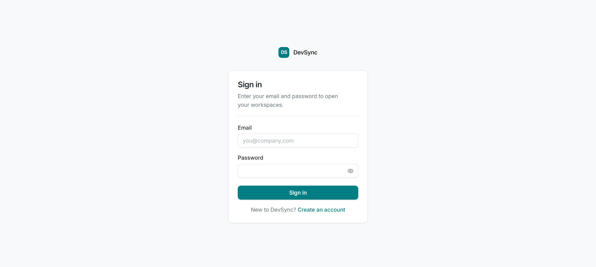
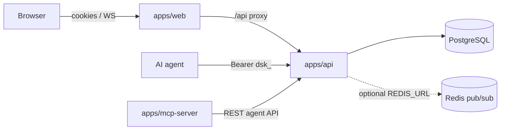
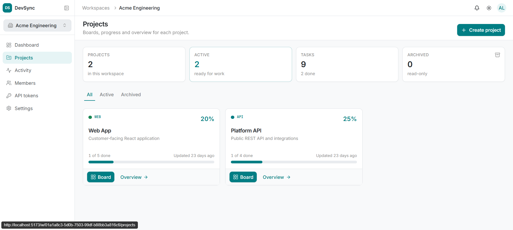
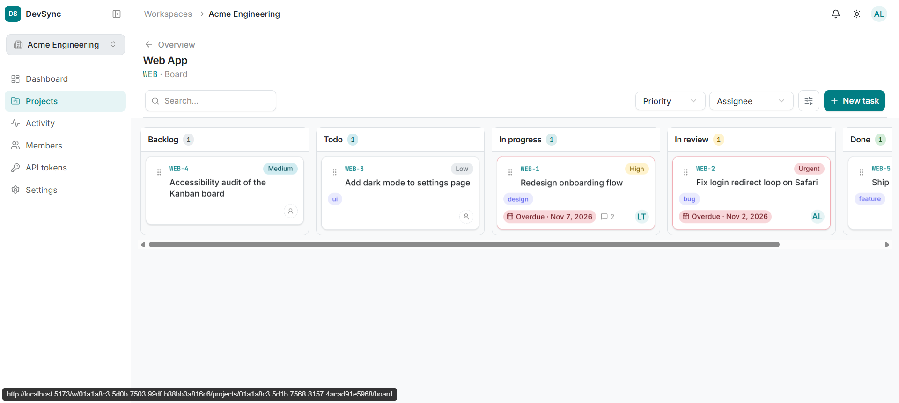
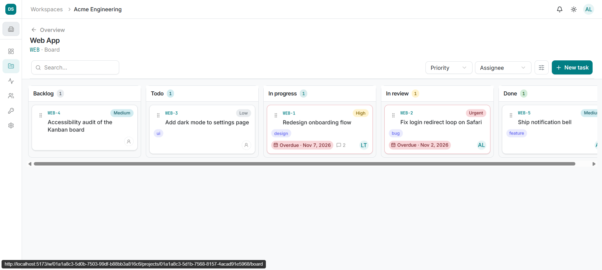
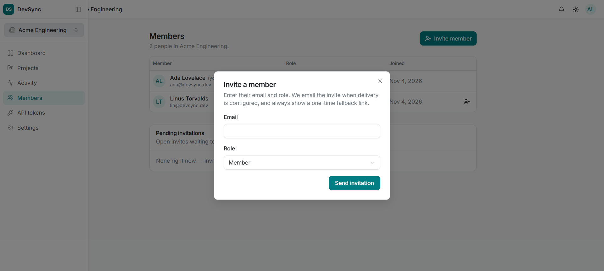

# DevSync

[](https://github.com/WilliamsLenkeu/devsync/actions/workflows/ci.yml)
[](LICENSE)
[](https://nodejs.org/)
[](https://pnpm.io/)

**Collaborative workspace for software teams** — Kanban, real-time presence, activity, and a first-class API + MCP surface for AI coding agents.

Product UI language: **English** · License: **[MIT](LICENSE)**



## Why DevSync

- **Team Kanban** with roles (Owner / Admin / Member / Viewer) enforced on the API — not only in the UI
- **Real-time** WebSocket events (optional **Redis** fan-out for multi-node)
- **Invitations by email** (Resend) with secure one-time fallback link
- **Task attachments** (local disk, MIME allowlist, size cap)
- **Agent-ready**: scoped API tokens (`dsk_…`) + [`apps/mcp-server`](apps/mcp-server/README.md)

## Stack

| Layer | Tech |
| --- | --- |
| Web | React, TypeScript, Vite, Tailwind, shadcn/ui, TanStack Query, GSAP |
| API | Node.js, Fastify, Zod, Prisma 7, PostgreSQL, WebSocket |
| Agents | REST `/api/agent/*` + MCP stdio client |
| Tooling | pnpm workspaces, Vitest, ESLint, Prettier, GitHub Actions |
| Containers | `docker-compose.yml` (local default: **wslc** / `wslc-compose`) |

## Architecture



Monorepo: `apps/api` · `apps/web` · `apps/mcp-server` · `packages/shared`

Docs index: [`docs/README.md`](docs/README.md) · API contract: [`docs/api-contract.md`](docs/api-contract.md) · Decisions: [`docs/decisions.md`](docs/decisions.md)

## Prerequisites

- Node.js ≥ 22 (24 recommended), pnpm 11 (`corepack enable`)
- PostgreSQL 16
- Git
- Optional: Redis 7 (multi-node realtime)

## Quick start

```powershell
pnpm install
Copy-Item .env.example .env
# Set JWT_ACCESS_SECRET to ≥ 32 random characters
pnpm db:up
pnpm --filter @devsync/api db:migrate
pnpm --filter @devsync/api db:seed
pnpm --filter @devsync/api dev       # http://localhost:3000  · OpenAPI /docs
pnpm --filter @devsync/web dev       # http://localhost:5173
```

**Demo accounts** (after seed): `ada@devsync.dev` / `lin@devsync.dev` — password `devsync-demo-123` (override with `DEMO_PASSWORD`).

Open **`http://localhost:5173`** (not `127.0.0.1`) so the Origin matches `WEB_ORIGIN`.

More: [CONTRIBUTING.md](CONTRIBUTING.md) · [docs/procedures.md](docs/procedures.md)

## Environment

Copy `.env.example` → `.env`. Never commit `.env`.

| Variable | Required | Notes |
| --- | --- | --- |
| `DATABASE_URL` | yes | PostgreSQL |
| `JWT_ACCESS_SECRET` | yes | ≥ 32 chars |
| `WEB_ORIGIN` | no | Default `http://localhost:5173` |
| `RESEND_API_KEY` | no | Invitation email; skipped if unset |
| `REDIS_URL` | no | Multi-node event fan-out |
| `ATTACHMENTS_DIR` | no | Default `.data/attachments` |
| `DEVSYNC_API_TOKEN` | MCP | Token `dsk_…` for the MCP server |

## Usage

| Surface | URL / entry |
| --- | --- |
| Web app | `http://localhost:5173` |
| OpenAPI | `http://localhost:3000/docs` |
| WebSocket | `GET /api/ws` (cookie auth) |
| Agent REST | `/api/agent/*` with `Authorization: Bearer dsk_…` |
| MCP | `pnpm --filter @devsync/mcp-server start` |

## Docker / wslc

```powershell
wslc-compose build api web
wslc exec devsync-db-1 psql -U devsync -c "CREATE DATABASE devsync_stack"
# STACK_DB=devsync_stack WEB_ORIGIN=http://localhost:8080 COOKIE_SECURE=true in .env
wslc-compose up migrate
wslc-compose up -d api web   # http://localhost:8080
```

Optional Redis: `wslc-compose --profile realtime up -d redis` then set `REDIS_URL`.

Plain Docker: same compose file with `docker compose`.

## Deploy web on Vercel (not run automatically)

Config is ready at the repo root: [`vercel.json`](vercel.json) + [`.vercelignore`](.vercelignore). The SPA stays same-origin on `/api` via a rewrite (cookies `SameSite=Lax` keep working).

When you are ready:

1. Replace `API_HOST_PLACEHOLDER` in `vercel.json` with your public API host (example: `api.example.com`).
2. On the **API** host, set `WEB_ORIGIN=https://<your-vercel-domain>` and `COOKIE_SECURE=true`.
3. From the repo root (pnpm workspace):

```powershell
pnpm dlx vercel link
pnpm dlx vercel          # preview
pnpm dlx vercel --prod   # production
```

Or import the GitHub repo in the Vercel dashboard (Root Directory = repository root, framework detected from `vercel.json`).

Optional local reference: [`apps/web/.env.example`](apps/web/.env.example). Do **not** set `VITE_API_ORIGIN` unless you intentionally leave same-origin mode.

## Testing

```powershell
pnpm typecheck
pnpm lint
pnpm test
```

## Screenshots










## Roadmap

- [x] Invitation email delivery (Resend)
- [x] Multi-node realtime (Redis pub/sub)
- [x] Task file attachments (local disk)
- [ ] OAuth / SSO
- [ ] Cross-node presence
- [ ] Object storage for attachments (S3-compatible)

## Security

- Argon2id passwords; refresh & API secrets stored hashed
- HTTP-only cookies, `SameSite=Lax`, Origin check, Helmet, rate limits
- Workspace authz via `authorize()` / `can()` — never UI-only
- Invitation tokens never logged; shown once at creation

## Contributing

See [CONTRIBUTING.md](CONTRIBUTING.md).

## License

[MIT](LICENSE) © 2026 DevSync contributors
