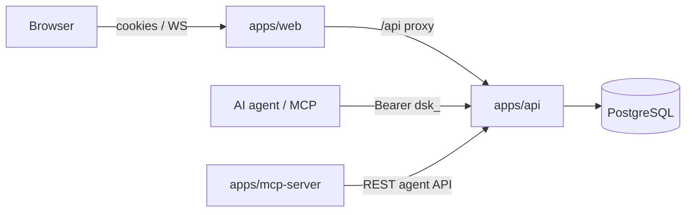
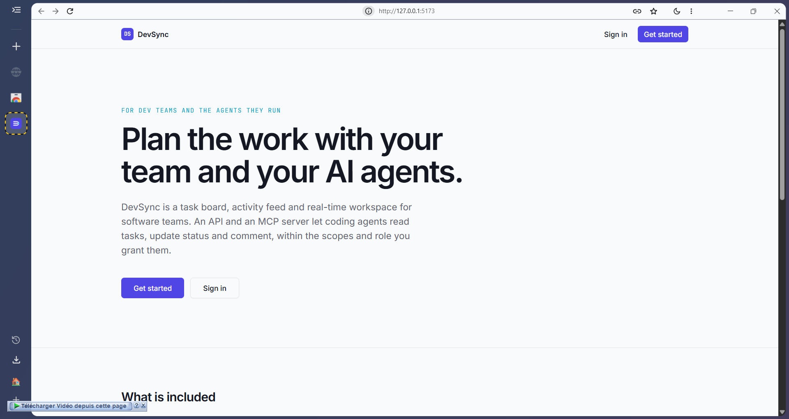
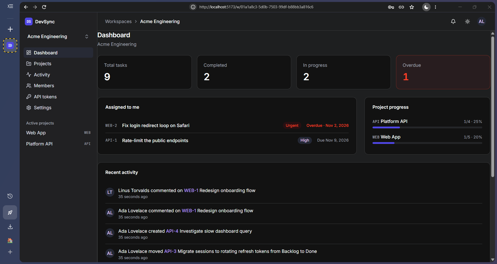
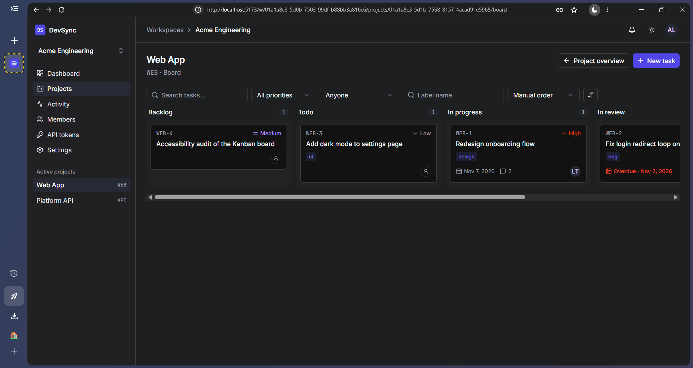

# DevSync

Collaborative workspace for software teams — somewhere between Linear, GitHub Projects, and a light coordination layer for AI coding agents.

Organize workspaces and projects, track tasks on a Kanban board, collaborate in real time, follow activity and notifications, and connect external agents through a scoped REST API and an [MCP](apps/mcp-server/README.md) server.

**Product language:** English · **License:** [MIT](LICENSE)

## Features

- Email/password auth (Argon2, HTTP-only cookies, refresh-token rotation)
- Workspaces with roles: Owner / Admin / Member / Viewer (enforced on the API)
- Projects, Kanban board with persistent drag-and-drop, comments, mentions
- Real-time WebSocket updates + in-app notifications
- Activity feed and workspace dashboard (real DB aggregates)
- Scoped API tokens + MCP tools for external AI agents

## Stack

| Layer | Tech |
| --- | --- |
| Web | React, TypeScript, Vite, Tailwind, shadcn/ui, TanStack Query |
| API | Node.js, Fastify, Zod, Prisma 7, PostgreSQL, WebSocket |
| Agents | REST `/api/agent/*` + MCP server (`@modelcontextprotocol/sdk`) |
| Tooling | pnpm workspaces, Vitest, Playwright, ESLint, Prettier, GitHub Actions |
| Containers | `wslc` / `wslc-compose` locally (Docker Compose compatible file) |

## Architecture



Monorepo: `apps/api`, `apps/web`, `apps/mcp-server`, `packages/shared`. Contract: [`docs/api-contract.md`](docs/api-contract.md). Decisions: [`docs/decisions.md`](docs/decisions.md).

## Prerequisites

- Node.js ≥ 22 (24 recommended), pnpm 11 (`corepack enable`)
- PostgreSQL 16 via **wslc-compose** (this repo’s default) or Docker Compose
- Git

## Quick start

```powershell
pnpm install
Copy-Item .env.example .env
# set JWT_ACCESS_SECRET to ≥ 32 random characters
pnpm db:up
pnpm --filter @devsync/api db:migrate
pnpm --filter @devsync/api db:seed   # optional demo: ada@ / lin@devsync.dev
pnpm --filter @devsync/api dev       # http://localhost:3000  OpenAPI /docs
pnpm --filter @devsync/web dev       # http://localhost:5173
```

Demo accounts after seed: `ada@devsync.dev` / `lin@devsync.dev` — password `devsync-demo-123` (override with `DEMO_PASSWORD`).

See [CONTRIBUTING.md](CONTRIBUTING.md) and [docs/procedures.md](docs/procedures.md) for DB reset, stack containers, JWT rotation, and wslc quirks.

## Environment

Copy `.env.example` → `.env`. Required: `DATABASE_URL`, `JWT_ACCESS_SECRET`. Web origin defaults to `http://localhost:5173`. MCP: `DEVSYNC_API_URL`, `DEVSYNC_API_TOKEN` (`dsk_…`).

Never commit real secrets.

## Docker / wslc

```powershell
wslc-compose build api web
wslc exec devsync-db-1 psql -U devsync -c "CREATE DATABASE devsync_stack"
# STACK_DB=devsync_stack WEB_ORIGIN=http://localhost:8080 in .env
wslc-compose up migrate
wslc-compose up -d api web   # web :8080 → proxies /api (+ WS)
```

Plain Docker: same `docker-compose.yml` with `docker compose`.

## Testing

```powershell
pnpm typecheck
pnpm lint
pnpm test                                 # unit + API injection (needs DB)
```

GUI smoke on this machine: run API + web, open `http://localhost:5173` (**localhost**, not `127.0.0.1` — must match `WEB_ORIGIN`), sign in with the demo accounts. Prefer **agent-desktop** for desktop QA (Playwright is optional and not required locally).

## API documentation

- Interactive OpenAPI UI: `http://localhost:3000/docs`
- Contract (routes, shapes, WS events): [`docs/api-contract.md`](docs/api-contract.md)

## MCP integration

Create an API token in the web UI (**API tokens**), then see [`apps/mcp-server/README.md`](apps/mcp-server/README.md) for Cursor / Claude Desktop config and the nine tools (`list_workspaces` … `get_project_activity`).

## Security

- Passwords hashed with Argon2id; refresh tokens and API secrets stored as SHA-256 only
- CSRF defence: `SameSite=Lax` cookies + Origin check on unsafe methods
- Rate limits on auth routes; Helmet; explicit CORS
- Workspace authorization centralized in `authorize()` (non-members get 404)
- Tokens are workspace-bound; effective rights = scopes ∩ current role

## Screenshots

Real captures via **agent-desktop** (Chrome / Windows):







## Roadmap

- [ ] Email delivery for invitations (currently one-time link shown to admin)
- [ ] Multi-node realtime (Redis / PG LISTEN) — today single-process EventBus
- [ ] File attachments on tasks
- [ ] OAuth / SSO

## Contributing

See [CONTRIBUTING.md](CONTRIBUTING.md).

## License

[MIT](LICENSE) © 2026 DevSync contributors
