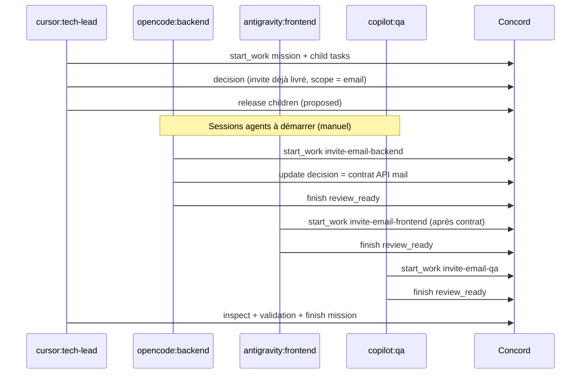

# Workflow de coordination Concord

## Boucle officielle (5 tools)

1. `start_work` — présence + claim + détection overlaps  
2. `inspect_work` — état workspace / tâche / inbox  
3. `update_work` — progress, decisions, assumptions, questions ; `prompt`/`reply` pour messages live  
4. `transfer_work` — assign / accept / decline / release / reassign / offer / reopen  
5. `finish_work` — evidence + review_ready / complete / closed  

Équivalent shell (utilisé par le Tech Lead avant reload MCP Cursor) :

```powershell
concord work start|inspect|update|transfer|finish --agent <id> --json <file|->
concord status ; concord who ; concord tasks ; concord messages
```

## Plan d’exécution mission `mission-invite-email`



## Parallélisation réaliste

| Phase | Parallèle ? | Qui |
| --- | --- | --- |
| Audit + setup Concord | Non | D |
| Conception MailPort + contrat | Non | A (D valide) |
| Impl backend mail | Non (bloque FE) | A |
| UI invite (après contrat) | Oui avec doc QA prep | B |
| QA | Non — après A+B | C |
| Doc multi-agent | Oui avec prep mission | D |

## État Concord au 2026-11-27 (après impl email)

| Task id | Status | Owner / note |
| --- | --- | --- |
| `mission-invite-email` | **active** | `cursor:tech-lead` — à closer par TL |
| `invite-email-impl-tl` | **active** | `cursor:tech-lead` — impl Resend E2E |
| `invite-email-backend` | **complete** | `opencode:e5fd0d5e` (Nvidia après free limit) |
| `invite-email-frontend` | **closed** | abandon (0 delivery) |
| `invite-email-qa` | **closed** | abandon (0 delivery) |
| `invite-email-frontend-v2` | **proposed** | parked |

Décisions enregistrées :

- CRUD/UI invitations déjà shippés — scope = email delivery (D10)  
- Resend via `mail.ts` + `emailDelivery` (D11) — dep `resend` acceptée  
- FE/QA lanes closed ; rewrite FE v2 non démarré  

Détail livré / ouvert : `experiment-report.md`.

## Gate qualité (avant `finish_work` complete sur la mission)

- `git status` / diff review  
- Tests ciblés + typecheck API ; web typecheck Landing/GSAP = dette connue hors invite  
- Pas de token d’invitation en logs  
- Contrat `docs/api-contract.md` à jour  
- Overlaps Concord résolus ou acceptés explicitement  

## Ce qui n’est PAS un substitut Concord

- Chats Cursor / Copilot / OpenCode isolés sans `update_work` / `prompt`  
- « On se parle » via fichiers markdown seuls (la doc multi-agent **trace**, Concord **orchestre**)
